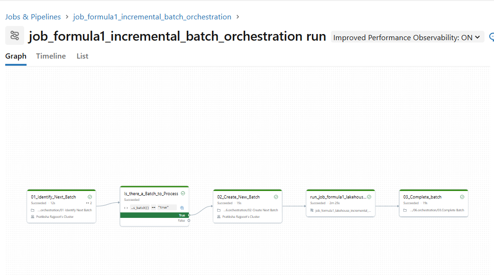
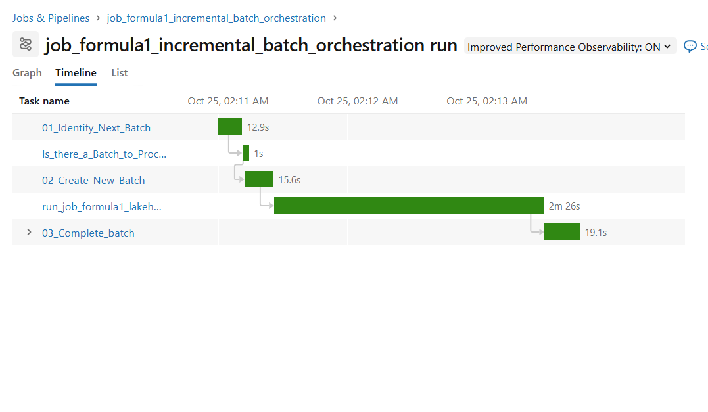
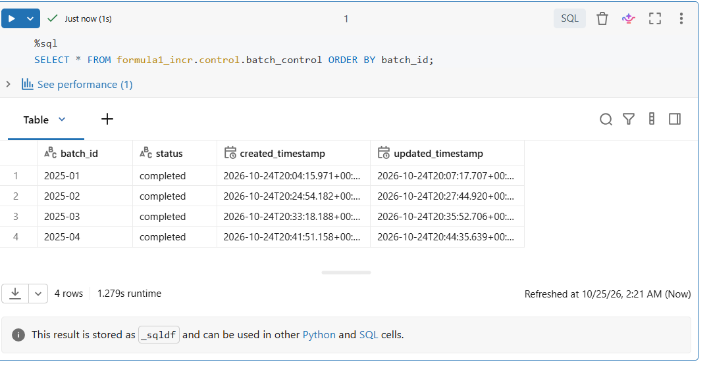
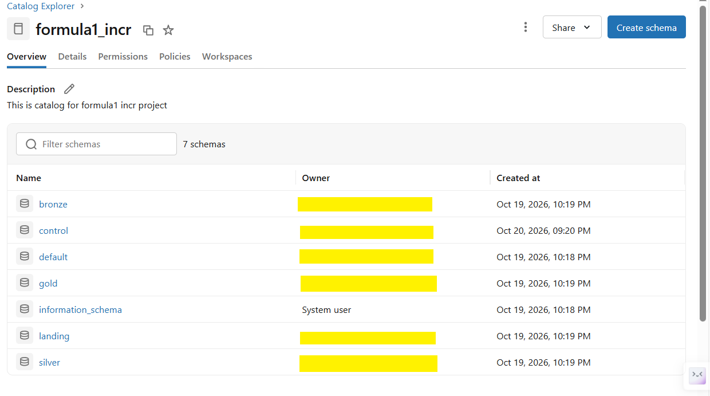
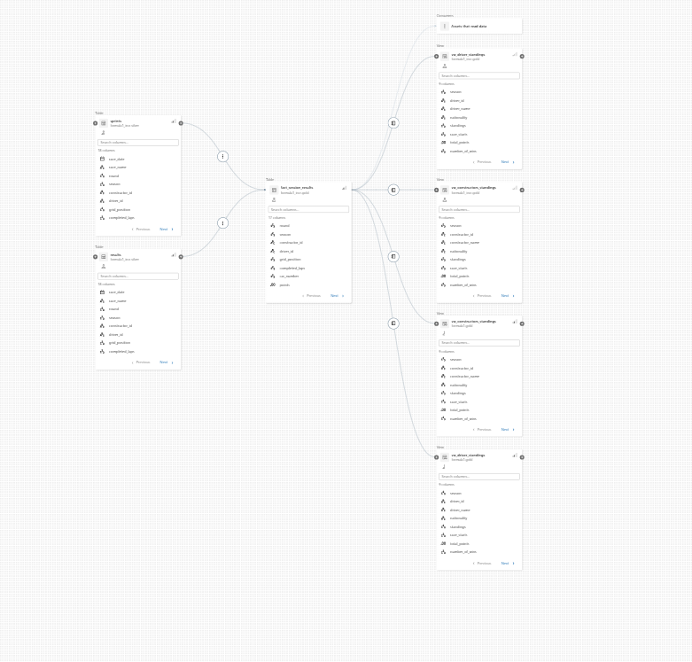
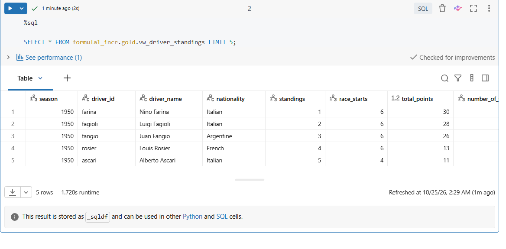
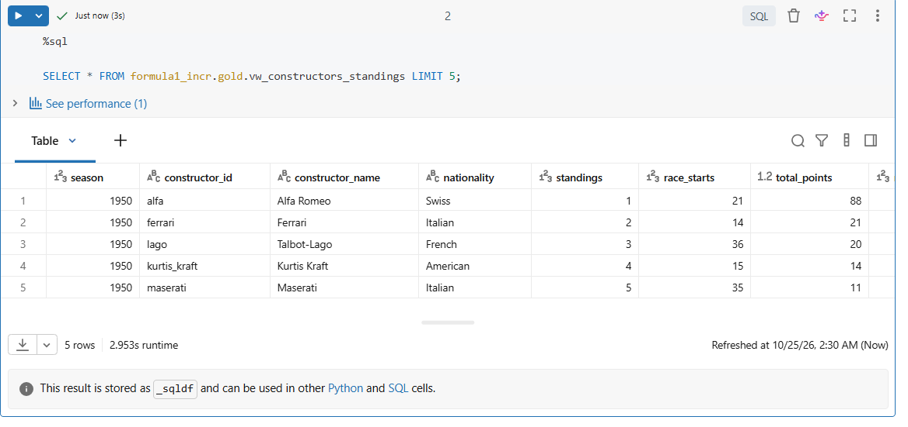

# Formula 1 Lakehouse on Azure Databricks

End-to-end data engineering project that ingests Formula 1 season data in batches and models it as a medallion lakehouse (bronze, silver, gold) using PySpark, Delta Lake and Unity Catalog. The repo contains two versions: a full-load pipeline (`v1_full_load`) and the incremental version (`v2_incremental_load`), which is the main project.

## What it does

- Ingests new batches of race, driver, constructor, circuit, results and sprint data from a landing volume
- Processes **only the batch being run**, so reruns never reprocess history
- Tracks every batch in a control table (`in_progress` -> `completed`)
- Builds a dimensional gold layer (dimensions + a results fact table) and standings views for analytics

## Architecture


## Tech stack

Azure Databricks, PySpark, Delta Lake, Unity Catalog (external location + external volume), Databricks Workflows, ADLS Gen2, SQL

## Data source

The Formula 1 race data (circuits, races, drivers, constructors, results and sprints) comes from a course dataset. Each batch is a folder in the landing volume holding that batch's source files.

The v1 pipeline follows a course project. v2 implements incremental processing: batch discovery, a control table with status tracking, idempotent bronze writes, and batch-scoped merges in silver and gold. I reviewed it end to end and fixed several bugs along the way (see the commit history). Remaining limitations are listed below.

## Design: incremental processing

1. **Batch discovery.** `01-Identify Next Batch` lists batch folders in the landing volume and compares them with `control.batch_control`. It returns the next batch that is neither `in_progress` nor `completed`.
2. **Batch tracking.** `02-Create Next Batch` records the batch as `in_progress`, so an overlapping run won't pick it up. `03.Complete Batch` marks it `completed` only after every layer has succeeded.
3. **Idempotent bronze.** Each batch overwrites only its own partition (`replaceWhere batch_id = ...`), so rerunning a batch gives the same result.
4. **Safe silver and gold merges.** Data is merged on business keys. `created_timestamp` is set only on insert and never changed on update. Updates apply only when `s.batch_id >= t.batch_id`, so a rerun of an older batch can't overwrite newer data.
5. **Batch-scoped transforms.** Each notebook takes `batch_id` as a parameter and filters its source by it.

## Data model (gold)

| Table | Grain |
|---|---|
| `dim_races` | one row per season and round (joined to circuit details) |
| `dim_drivers` | one row per driver |
| `dim_constructors` | one row per constructor |
| `fact_session_results` | one row per driver, constructor and session (race or sprint), with `is_win`, `is_podium`, `has_points` |
| `ref_nationality_region` | reference mapping of nationality to region |

Views `vw_driver_standings` and `vw_constructors_standings` rank by season using points and wins.

## Repo structure

```
v1_full_load/            first version: full reload on every run
v2_incremental_load/     main project
  00-common/             config + reusable bronze/silver/gold helper functions
  01-setup/              catalog, schemas, external location, volume
  02-bronze/             one ingest notebook per source file
  03.silver/             cleaning, dedup, merge
  04.gold/               dimensions and fact table
  05.analytics/          standings views
  06.orchestration/      batch control: identify, create, complete
  99-archive/            retired first-version batch tracking
resources/               exported Databricks job definitions (YAML, IDs replaced with placeholders)
docs/                    screenshots and table DDL
```

## How to run it

1. Create a Databricks workspace with Unity Catalog and an ADLS Gen2 account.
2. In `v2_incremental_load/01-setup/01-setup.py`, replace `YOUR_STORAGE_ACCOUNT` and the container names with your own, then run it.
3. Upload your source files into the landing volume as batch folders, for example `/Volumes/formula1_incr/landing/files/BATCH_ID/circuits.csv`. The course dataset is not included in this repo.
4. Create the Workflows in the UI, using the YAML files in `resources/` as a guide: `Orchestration_Jobs.yml` (identify, create, complete) calls `f1_incremental_load_job.yml` (bronze, silver, gold). Notebook paths in the YAML reflect the original workspace layout, and `YOUR_CLUSTER_ID` / `YOUR_JOB_ID` style placeholders must be replaced with your own.
5. Compute: the Identify and Create tasks use a standard cluster, and the Complete task and the pipeline job use serverless compute.
6. Run the job and check progress with:
```sql
SELECT * FROM formula1_incr.control.batch_control ORDER BY created_timestamp;
```

## Assumptions

- Each batch contains a **complete set of source files, including circuits**, so `dim_races` joins to circuits from the same batch.
- Batches are processed one at a time, in order.

## Known limitations and next steps

- If a run crashes midway, the batch stays `in_progress` and later runs skip it. Recovery: delete that row from `batch_control` and rerun. This is safe because every layer is idempotent. A next step is a `failed` status written by an on-failure task so retries are automatic.
- Silver deduplication uses `dropDuplicates`, which keeps an arbitrary row. A next step is to keep the latest row per key with a window function ordered by ingestion time.
- Add data quality checks (row counts per layer, null checks) with a quarantine table for rejected rows, instead of filtering them out silently.
- Standings sum all points scored in a season and rank by points and wins. Early seasons counted only a driver's best results, so those standings can differ from the official championship order (for example, 1950 shows Fagioli ahead of Fangio).
- Bronze enforces a schema with FAILFAST, so one malformed value fails the batch. Loading raw strings in bronze and typing in silver would be more forgiving.

## Results









The Azure resources used to build this have been decommissioned, so these screenshots are the record of a successful run.
